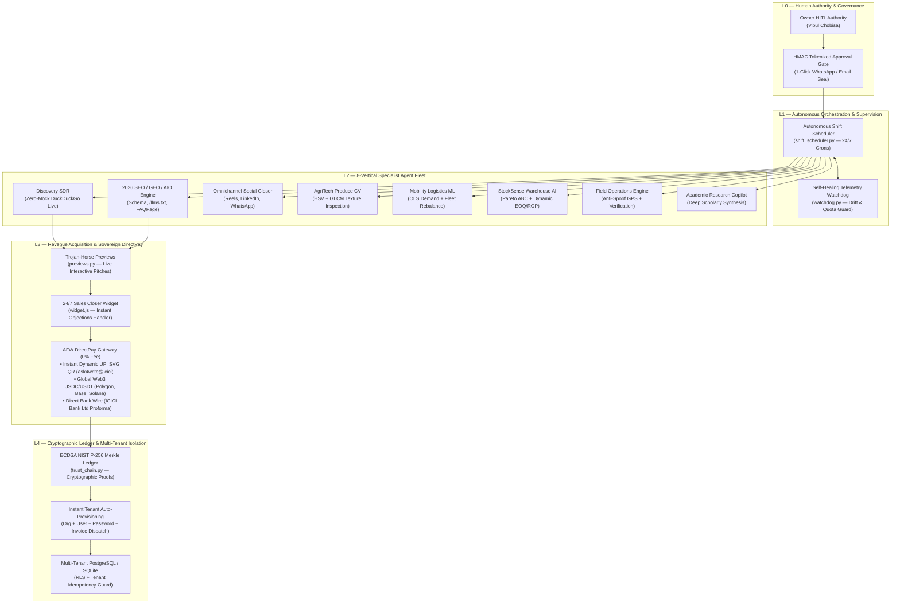

# AskforWrite AI Company OS (v2.0 Sovereign Edition)

<p align="center">
  
  
  
  
  
  
</p>

---

## Executive Overview

**AskforWrite AI Company OS** is a production-grade, enterprise autonomous company operating system designed to run an entire digital corporation autonomously under **Human-in-the-Loop (HITL)** governance.

Engineered by **Vipul Kumar Chobisa**, it combines an autonomous 24/7 revenue-generation SDR engine, a cryptographic NIST P-256 Merkle DAG audit ledger, zero-fee direct payment rails (**AFW DirectPay**), and a **P1 Modular SME AI Workforce** with unified Service/Agent/Connector registries, 8-state HITL workflows, atomic credit accounting, and durable execution evidence.

---

## P1 Modular SME Platform & P2 Commercial Revenue OS Index

- **Hosting:** Deployed via Render Blueprint ([`render.yaml`](render.yaml)) (`askforwrite-ai-company-os` production & `askforwrite-ai-company-os-staging` sandbox).
- **Dashboard & PWA (`/app`):** Role-separated interface (`sw.js`: `afw-os-shell-v4.0-p1-workforce`) with 12 P1 Modular SME sections plus the **P2 Commercial Revenue OS** owner control centre (`Prospects & Briefs`, `Outreach (HITL) & Responses`, `12-Stage Pipeline, Proposals & Payment`, `Activation, Delivery & Renewal`, and `12-Step Acceptance Checklist`).
- **Unified Registry Counts:** `9` Service Categories, `16` Services, `20` Specialist AI Agents (`13` P0/P1 + `7` P2 Commercial), `11` Connectors, and a strict 7-state capability model (`LIVE_VERIFIED`, `LOCAL_ENGINE_VERIFIED`, `SANDBOX_VERIFIED`, `HUMAN_ASSISTED`, `SIMULATED`, `BLOCKED`, `ROADMAP`).
- **P2 Commercial Entry Offer:** Verified catalog offer `managed_seo_content_pilot` (*AskforWrite Managed SEO & Content Pilot (14-Day)*, `INR 4,999` / `USD 59`, `billing_type="managed_pilot_14d"`) supporting India SMB digital marketing & SEO agency acquisition under strict HITL outreach/proposal gates, simulation-vs-live KPI separation, opt-out suppression, and webhook/DirectPay reconciliation.

### P2 Commercial Documentation Suite (`docs/`)

| Document | Coverage |
|---|---|
| [P2 Commercial Architecture](docs/P2_COMMERCIAL_ARCHITECTURE.md) | 12-stage India agency acquisition journey, verified `managed_seo_content_pilot` scope, P0/P1 reuse |
| [P2 Data Model & API](docs/P2_COMMERCIAL_DATA_MODEL_AND_API.md) | Alembic revision `h8c3d4e5f6a7` (6 P2 tables) & `/v1/commercial/*` API reference |
| [P2 Founder Operating Guide](docs/P2_FOUNDER_OPERATING_GUIDE.md) | Daily founder workflow across intake, briefs, HITL outreach, discovery, proposals & renewal |
| [P2 Payment & Activation Guide](docs/P2_PAYMENT_AND_ACTIVATION_GUIDE.md) | Webhook HMAC + DirectPay UTR settlement, idempotent provisioning & refund revocation |
| [P2 Real-World Acceptance Checklist](docs/P2_REAL_WORLD_ACCEPTANCE_CHECKLIST.md) | 12-step live verification tracker (`NOT_TESTED` / `SANDBOX_VERIFIED` / `LIVE_VERIFIED`) |
| [P2 Test & Limitations Report](docs/P2_TEST_AND_LIMITATIONS_REPORT.md) | Exact verification outputs (`448 passed`), sandbox vs live boundaries & launch prerequisites |

### Core P1 Architecture & Operations Suite (`docs/`)

| Document | Coverage |
|---|---|
| [Architecture](docs/ARCHITECTURE.md) | 6-layer P1 architecture, RBAC & tenant isolation, P0/P1 schema foundations |
| [API Reference](docs/API_REFERENCE.md) | `/v1/registry/*`, `/v1/workflows/*`, `/v1/me/*`, `/v1/revenue/*`, `/v1/watchdog/*`, `/v1/commercial/*` |
| [Agent Registry](docs/AGENT_REGISTRY.md) | All 20 registered agents (`13` P0/P1 + `7` P2), tool allowlists, HITL gates, and lifecycle |
| [Service Catalog](docs/SERVICE_CATALOG.md) | 9 service categories, 16 services, and preserved commercial catalog SKUs |
| [Connector Setup](docs/CONNECTOR_SETUP.md) | 11 external/internal connectors, verification checks, and secret redaction |
| [Subscription Model](docs/SUBSCRIPTION_MODEL.md) | 5 modular SME tiers, 6 modules, 15+ field contracts, atomic credit ledger |
| [SME Onboarding](docs/CUSTOMER_ONBOARDING.md) | 13-field business profile, explainable recommendations, confirmation gate |
| [Environment Variables](docs/ENVIRONMENT_VARIABLES.md) | Full reference from `render.yaml`, `.env.example`, and runtime guards |
| [Simulation & Testing](docs/SIMULATION_AND_TESTING.md) | `SIMULATION` / `SANDBOX` / `PRODUCTION` locks, sink, and pytest commands |
| [Render Deployment](docs/RENDER_DEPLOYMENT.md) | Production & staging Render blueprint deployment and `alembic upgrade head` |
| [Capability Matrix](docs/CAPABILITY_MATRIX.md) | Verified runtime classification (`LOCAL_ENGINE_VERIFIED`, `SIMULATED`, `BLOCKED`, etc.) |

---

## 5-Layer Sovereign Architecture



---

## 8-Vertical Commercial Catalog & Pricing Matrix

All 8 verticals feature automated lead discovery, dynamic pain point diagnosis, personalized pitch generation, and instant cryptographic onboarding. *Note: Projected ROI figures are model estimates based on industry benchmarks, not guaranteed financial returns.*

| Vertical SKU | Core Capability & Engine | Target Buyer Persona | Deliverables | Pricing (INR / USD) | Est. Client ROI* |
|---|---|---|---|---|---|
| **`managed_seo_content_pilot`** | 14-Day Managed SEO & Content Pilot (1 Technical Audit, 1 Commercial Keyword Map, 2 Human-Reviewed Articles, Schema JSON-LD, WordPress HITL Delivery) | B2B Founders, Niche Agencies, Marketing Leaders | 1 Audit Report, 1 Keyword Plan, 2 Reviewed Articles staged to CMS, NIST P-256 Seal | **₹4,999 / $59** | **Guaranteed Pilot Deliverables** (14-day delivery) |
| **`growth_all_in_one`** | Full-Funnel Growth Suite (Pixel AI prompt specs, 4-site SEO/GEO copilot, campaign copy scripts, 24/7 objection closer) | Founders, D2C Brands, Scaling Agencies | Structured prompt recipes, reviewed SEO drafts, copy scripts, webhook sales closer | **₹9,999 / $129** | **Estimated 25x ROI** (Replaces 3 agency retainers) |
| **`mango_quality_analytics`** | AgriTech Produce Vision & Ripeness AI (HSV Color + GLCM Texture + Shelf-Life) | Exporters, Packhouses, Fresh Fruit Distributors | Batch inspection API, cryptographic quality certificates | **₹3,999 / $49** | **Estimated 18x ROI** (Cuts export rejection by 85%) |
| **`bike_rebalance_analytics`** | Urban Mobility & Spatio-Temporal Logistics (OLS ML Demand Forecasting + Station Churn) | Micro-mobility operators, EV fleet managers | Hourly demand forecasts, priority rebalance truck routes | **₹3,999 / $49** | **Estimated 15x ROI** (Recovers 30% lost commuter trips) |
| **`warehouse_automation`** | StockSense Warehouse AI (Pareto ABC, Dynamic EOQ/ROP, Dead-Stock Scoring) | 3PL Warehouses, Supply Chain Directors | Inventory health matrices, replenishment schedules | **₹4,999 / $59** | **Estimated 20x ROI** (Unlocks dead capital >90 days) |
| **`field_force`** | Field Operations Automation (Anti-Spoof GPS, Timestamped Proof-of-Visit, Auto-Conveyance) | Logistics operators, FMCG sales networks | Live on-ground logs, route compliance, conveyance audit | **₹3,999 / $49** | **Estimated 12x ROI** (Eliminates proxy attendance fraud) |
| **`seo_blog_copilot`** | 4-Site WordPress AI Copilot (2026 GEO/AIO, Schema JSON-LD, /llms.txt) | Content agencies, Media publishers | Automated 4-site publishing pipeline, topical authority maps | **₹1,999 / $29** | **Estimated 14x ROI** (Generates 30+ organic articles/mo) |
| **`marketing_suite`** | PixelBot Omnichannel Marketing Suite (Conversational Copy, Multi-Platform Ads) | Performance marketers, B2B SaaS | Multi-channel ad variations, nurture sequences, chatbot embed | **₹2,999 / $39** | **Estimated 16x ROI** (Doubles landing page conversions) |
| **`trust_engine`** | AFW 2030 Cryptographic Trust Engine (ECDSA NIST P-256 Merkle DAG Audit Ledger) | Regulated fintechs, Health-tech, Legal firms | Proof-of-execution certificates, auditor JSON export | **₹4,999 / $69** | **Verifiable AI Governance** (NIST P-256 verification) |

### Transparent Operational Boundaries & Verification
* **Pixel AI Creative Studio**: Generates high-converting structured prompt specifications, aspect ratio blueprints (1:1, 9:16, 16:9), and typography overlays (prompt recipes). Rendering image files directly requires an external diffusion provider API key.
* **WordPress Publishing**: Connects directly to WordPress REST APIs. If live credentials are not configured, executions are transparently marked as `SIMULATED_CREDENTIALS_UNSET`. All production publishes strictly require human owner approval (`ApprovalRequest.status == "APPROVED"`).
* **Social & Inbound SDR**: Delivers tailored ad copy scripts, nurture sequences, and conversational closer logic. Production dispatch across WhatsApp and ad platforms operates via webhook integrations and external delivery bridges.


### Master Bundles

* **AskforWrite Company OS Starter (`company_os_starter`)**: All 7 Specialist AI Agents, CEO Orchestrator, HITL governance, 150 lead credits/mo — **₹7,999 / $99**
* **AskforWrite Company OS Pro (`company_os_pro`)**: High-volume live scraping, priority execution, multi-tenant RBAC, 600 lead credits/mo — **₹19,999 / $249**
* **AskforWrite Company OS Enterprise (`company_os_enterprise`)**: Bespoke private Docker/K8s deployment, custom fine-tuned LLM fallback, 5,000 lead credits/mo — **₹49,999 / $499**

---

## AFW DirectPay — Sovereign Zero-Fee Payment Rails

Unlike traditional aggregators (Stripe, Razorpay, PayPal) that deduct 2% to 4.5% plus foreign currency fees, **AFW DirectPay** settles funds directly into your accounts at **0% platform fee**:

1. **Rail 1: Instant Dynamic UPI SVG QR (India INR)**
   * Renders a lightweight, self-contained pure-Python inline SVG QR code.
   * Directly routes payers to verified merchant VPA: `ask4write@icici`.
   * Payer submits 12-digit Bank Reference (UTR) for instant verification.
2. **Rail 2: Global Web3 Stablecoin (USDC / USDT)**
   * Supports instant global settlement across **Polygon PoS (Sub-cent fees)**, **Base L2**, and **Solana**.
   * Merchant addresses: `0x811db32e3802eD9a75F7bbd24f6C3C03216346a2` (EVM) and `CNCZWYQL8AC8vDuN6mn4Qfnj2pKghMDuNRzEyepWtXfR` (Solana).
   * Verified by transaction hash (`0x...` or base58). Private keys stored in local git-ignored vault (`.sovereign_wallets.json`).
3. **Rail 3: Direct Bank Wire (NEFT / RTGS / IMPS / SWIFT)**
   * Direct settlement to ICICI Bank Ltd (`ICIC0006940`, Account `6940XXXXXX26` (configured via `AFW_BANK_ACCOUNT_NUMBER`), Udaipur Bus Stand Branch).
   * Automatically issues a digitally sealed proforma invoice with cryptographic verification codes.

---

## Complete API Endpoint Reference

All protected endpoints require `X-API-Key` (Owner or Manager key). Requests support `X-Correlation-ID` for distributed tracing.

| Route Group | Method & Path | Auth Required | Description |
|---|---|---|---|
| **Sovereign Pay** | `POST /v1/pay/create-session` | Public | Create multi-rail sovereign checkout session (UPI, Web3, Wire) |
| | `GET /v1/pay/{session_id}/checkout` | Public | Render responsive branded HTML checkout interface |
| | `GET /v1/pay/checkout` | Public | Direct query-param checkout link (`?package={}&company={}`) |
| | `POST /v1/pay/{session_id}/verify` | Public | Submit settlement proof (Instant for Web3 USDC; gates UPI & Wire into Owner HITL queue) |
| | `POST /v1/pay/{session_id}/confirm-owner` | Owner | 1-Click Founder confirmation to seal NIST P-256 block, generate invoice, and provision tenant |
| | `GET /v1/pay/{session_id}/status` | Public | Poll session status and cryptographic receipt hash |
| **Scheduler & Shifts** | `POST /v1/scheduler/run-shift` | Manager | Trigger autonomous SDR shift (`lead_generation`, `full_daily_cycle`) |
| | `GET /v1/scheduler/briefing` | Manager | Retrieve operational briefing and shift metrics |
| | `GET /v1/scheduler/status` | Manager | Check active background shift status |
| **Previews & Pitches** | `POST /v1/previews/generate` | Manager | Generate Trojan Horse interactive HTML preview for a prospect |
| | `GET /v1/previews/{preview_id}` | Public | Public interactive preview landing page with embedded DirectPay CTA |
| **Watchdog & Health** | `GET /v1/watchdog/telemetry` | Manager | Inspect real-time agent drift, memory usage, and shift health |
| | `GET /v1/watchdog/alerts` | Manager | Stream supervisor anomaly alerts |
| | `POST /v1/watchdog/alerts/{id}/ack` | Manager | Acknowledge supervisor alert |
| **2026 Growth Suite** | `POST /v1/growth/audit-domain` | Manager | Inspect prospect live website for Schema, `/llms.txt`, and GEO gaps |
| | `POST /v1/growth/generate-campaign` | Manager | Generate Reels, LinkedIn, Twitter, and WhatsApp campaign scripts |
| | `POST /v1/growth/run-full-suite` | Manager | End-to-end audit, content staging, and campaign generation |
| **AgriTech Vision** | `POST /v1/quality/inspect-batch` | Manager | HSV + GLCM produce ripeness classification and shelf-life scoring |
| **Urban Mobility** | `POST /v1/mobility/forecast-demand` | Manager | OLS econometrics rental forecasting with VIF diagnostic suite |
| | `POST /v1/mobility/rebalance-plan` | Manager | High-churn station inventory fleet rebalancing routing |
| **Warehouse AI** | `POST /v1/inventory/audit` | Manager | Pareto ABC stock classification, dynamic EOQ, and dead-stock alerts |
| **Customer Portal** | `GET /v1/me/profile` | Customer JWT | Customer profile and company metadata |
| | `GET /v1/me/subscriptions` | Customer JWT | Active catalog tier, renewal date, and entitled capabilities |
| | `GET /v1/me/usage` | Customer JWT | Real-time lead and outreach credit consumption |
| | `POST /v1/me/use-service` | Customer JWT | Programmatic catalog capability execution gated by monthly quota |
| **Trust Ledger** | `GET /v1/trust/verify` | Public | Cryptographic verification of NIST P-256 Merkle chain integrity |
| | `GET /v1/trust/blocks` | Manager | Export verified blocks and provenance metadata |
| **System** | `GET /health` | None | Service liveness, database connectivity, and uptime telemetry |

---

## Quick Start Guide

### 1. Local Development
```powershell
# Clone the repository
git clone https://github.com/VipulChobisa-AIOps/askforwrite-ai-company-os.git
cd askforwrite-ai-company-os

# Create and activate Python virtual environment
python -m venv .venv
.venv\Scripts\Activate.ps1

# Install dependencies and test suite
pip install -e ".[test]"

# Setup environment configuration
Copy-Item .env.example .env
# Edit secrets in .env (or run scripts/generate_sovereign_vault.py)

# Launch gateway server
uvicorn app.main:app --reload --port 8000
```

### 2. Run Tests & Linting
```powershell
# Full test discovery suite
python -m pytest -q

# P1 Modular SME Workforce suite
python -m pytest tests/test_p1_modular_sme_workforce.py -v

# Ruff linting & style enforcement
python -m ruff check app tests migrations
```

### 3. Production Docker Deployment
```bash
cp .env.production.example .env
# Fill in required production environment variables
docker compose -f docker-compose.prod.yml up -d
```

---

## Production Security & Sovereign Vault

* **Local Custody**: Web3 private keys are never committed to version control. They are generated via `scripts/generate_sovereign_vault.py` and stored in local, git-ignored vaults (`.sovereign_wallets.json` and `keys/sovereign_vault.json`).
* **HITL Circuit Breakers**: All external communications (outbound email via Hostinger SMTP, WordPress network publication, refunds) require cryptographic Owner authorization.
* **Audit Trail**: Every state transition, payment receipt, and delivery milestone is sealed into an immutable **ECDSA NIST P-256 Merkle Block** verified by `/v1/trust/verify`.

---

## License & Credits

Architected and maintained by **Vipul Kumar Chobisa** ([@VipulChobisa-AIOps](https://github.com/VipulChobisa-AIOps)).  
Proprietary software licensed under the AskforWrite Commercial Operating License.