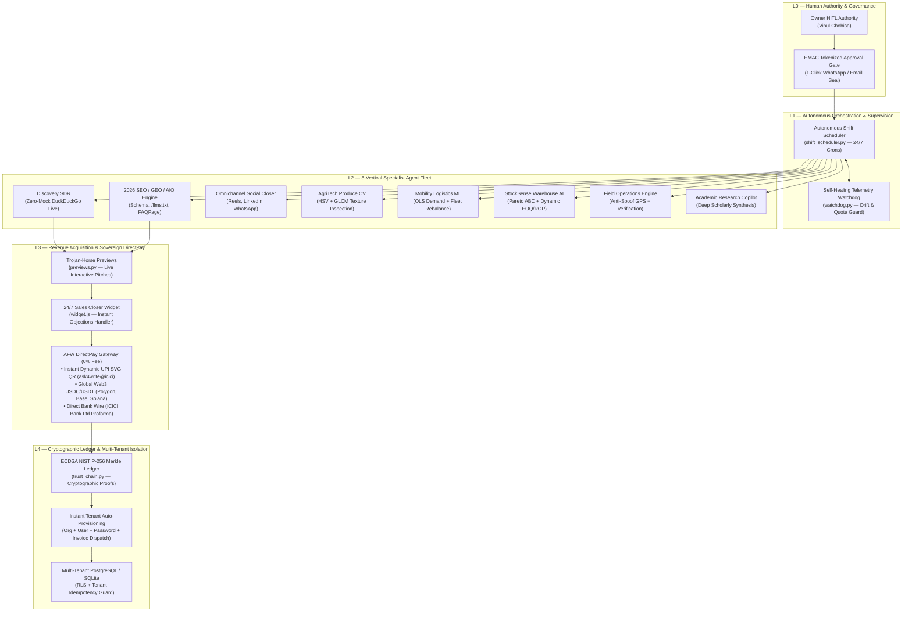

# AskforWrite AI Company OS (v2.0 Sovereign Edition)

<p align="center">
  <a href="https://github.com/VipulChobisa-AIOps/askforwrite-ai-company-os/actions/workflows/ci.yml">
    
  </a>
  
  
  
  
  
</p>

> **Release Readiness Status:** **PRE-PRODUCTION / `BLOCKED` FOR COMMERCIAL CUTOVER** (`production_cutover_approved: false`). Core P0 security, multi-tenant isolation, WordPress HITL fail-closed enforcement, and payment provisioning fail-closed controls are implemented and locally tested. Live staging verification, secret rotation in Render, production Neon migration, and a first verified real-customer pilot payment (`managed_seo_content_pilot`) remain required before declaring production earning readiness. See [`docs/P3_1_RELEASE_READINESS_REPORT.md`](docs/P3_1_RELEASE_READINESS_REPORT.md) and [`docs/SECURITY_HARDENING_AUDIT_REPORT.md`](docs/SECURITY_HARDENING_AUDIT_REPORT.md).

---

## Executive Overview

**AskforWrite AI Company OS** is a multi-tenant, **Human-in-the-Loop (HITL)** AI operations platform engineered by **Vipul Kumar Chobisa**.

It combines modular SME business workflows (starting commercially with the **14-Day Managed SEO & Content Pilot**), an ECDSA NIST P-256 Merkle DAG audit ledger, multi-rail payment orchestration (**Razorpay**, **PayPal**, and **AFW DirectPay**), unified Service/Agent/Connector registries, 8-state HITL approval workflows, atomic credit accounting, and durable execution evidence. All outbound communications, WordPress publications, and refunds require explicit human authorization.

---

## P1 Modular SME Platform, P2 Commercial & P3 Customer Success Index

- **Hosting:** Deployed via Render Blueprint ([`render.yaml`](render.yaml)) (`askforwrite-ai-company-os` production & `askforwrite-ai-company-os-staging` sandbox).
- **Dashboard & PWA (`/app`):** Role-separated interface (`sw.js`: `afw-os-shell-v4.0-p1-workforce`) with 12 P1 Modular SME sections, **P2 Commercial Revenue OS**, and **P3 Customer Success & Growth** (5 tabs covering Customer 360 & Onboarding, Delivery & Health, Support & Improvement Loop, Subscriptions/Retention/Compliance, and Growth/Unit Economics/12-Step Acceptance Checklist).
- **Unified Registry Counts:** `9` Service Categories, `16` Services, `28` Specialist AI Agents (`13` P0/P1 + `7` P2 Commercial + `8` P3 Customer Success), `11` Connectors, and a strict 7-state capability model (`LIVE_VERIFIED`, `LOCAL_ENGINE_VERIFIED`, `SANDBOX_VERIFIED`, `HUMAN_ASSISTED`, `SIMULATED`, `BLOCKED`, `ROADMAP`).
- **P2 Commercial Entry Offer:** Verified catalog offer `managed_seo_content_pilot` (*AskforWrite Managed SEO & Content Pilot (14-Day)*, `INR 4,999` / `USD 59`, `billing_type="managed_pilot_14d"`) supporting India SMB digital marketing & SEO agency acquisition under strict HITL outreach/proposal gates, simulation-vs-live KPI separation, opt-out suppression, and webhook/DirectPay reconciliation.
- **P3 Customer Success & Growth Engine:** Manages post-sale lifecycle (`LEAD -> ONBOARDING -> ACTIVATION_PENDING -> ACTIVE -> AT_RISK -> SUSPENDED -> CHURNED -> CLOSED`), strict onboarding activation gates, delivery QA & GSC outcome guards, explainable Customer Health scores, org-scoped Support + HITL + Improvement Loop, idempotent subscription grace/suspension/recovery, HITL-gated refunds/upsells/referrals, `ACTUAL`/`ALLOCATED`/`ESTIMATED` unit economics & spend caps, DPDP/GDPR exports & legal-hold deletions, multi-tenant DLQ/concurrency readiness, and 12-step P3 real-world acceptance tracking.

### P3 Customer Success & Growth Documentation Suite (`docs/`)

| Document | Coverage |
|---|---|
| [P3 Customer Success Architecture](docs/P3_CUSTOMER_SUCCESS_ARCHITECTURE.md) | 10-stage lifecycle, P0/P1/P2 reuse, 8 CS agents (`28` total), epistemic & HITL safeguards |
| [P3 Lifecycle & Data Model](docs/P3_LIFECYCLE_AND_DATA_MODEL.md) | Alembic revision `i9d4e5f6a7b8` (12 P3 tables), FSMs, `/v1/cs/*` & `/v1/me/*` API reference |
| [P3 Operations & Runbook](docs/P3_OPERATIONS_AND_RUNBOOK.md) | Onboarding templates, QA & attribution guard, health alerts, HITL support/refunds/growth/deletion |
| [P3 Operational Readiness Report](docs/P3_OPERATIONAL_READINESS_REPORT.md) | Concurrency ceiling, timeout DLQ recovery, DB probe, backup drills & live constraints |
| [P3 Real-World Acceptance Checklist](docs/P3_REAL_WORLD_ACCEPTANCE_CHECKLIST.md) | 12-step live verification tracker (`NOT_TESTED` / `SANDBOX_VERIFIED` / `LIVE_VERIFIED`) |
| [P3 Test & Limitations Report](docs/P3_TEST_AND_LIMITATIONS_REPORT.md) | Historical P3 snapshot (`454 passed` at snapshot time), sandbox vs live boundaries & deployment constraints |

### P2 Commercial Documentation Suite (`docs/`)

| Document | Coverage |
|---|---|
| [P2 Commercial Architecture](docs/P2_COMMERCIAL_ARCHITECTURE.md) | 12-stage India agency acquisition journey, verified `managed_seo_content_pilot` scope, P0/P1 reuse |
| [P2 Data Model & API](docs/P2_COMMERCIAL_DATA_MODEL_AND_API.md) | Alembic revision `h8c3d4e5f6a7` (6 P2 tables) & `/v1/commercial/*` API reference |
| [P2 Founder Operating Guide](docs/P2_FOUNDER_OPERATING_GUIDE.md) | Daily founder workflow across intake, briefs, HITL outreach, discovery, proposals & renewal |
| [P2 Payment & Activation Guide](docs/P2_PAYMENT_AND_ACTIVATION_GUIDE.md) | Webhook HMAC + DirectPay UTR settlement, idempotent provisioning & refund revocation |
| [P2 Real-World Acceptance Checklist](docs/P2_REAL_WORLD_ACCEPTANCE_CHECKLIST.md) | 12-step live verification tracker (`NOT_TESTED` / `SANDBOX_VERIFIED` / `LIVE_VERIFIED`) |
| [P2 Test & Limitations Report](docs/P2_TEST_AND_LIMITATIONS_REPORT.md) | Historical P2 snapshot (`448 passed` at snapshot time), sandbox vs live boundaries & launch prerequisites |

### Core P1 Architecture & Operations Suite (`docs/`)

| Document | Coverage |
|---|---|
| [Architecture](docs/ARCHITECTURE.md) | 6-layer P1 architecture, RBAC & tenant isolation, P0/P1 schema foundations |
| [API Reference](docs/API_REFERENCE.md) | `/v1/registry/*`, `/v1/workflows/*`, `/v1/me/*`, `/v1/revenue/*`, `/v1/watchdog/*`, `/v1/commercial/*` |
| [Agent Registry](docs/AGENT_REGISTRY.md) | All 28 registered agents (`13` P0/P1 + `7` P2 + `8` P3), tool allowlists, HITL gates, and lifecycle |
| [Service Catalog](docs/SERVICE_CATALOG.md) | 9 service categories, 16 services, and preserved commercial catalog SKUs |
| [Connector Setup](docs/CONNECTOR_SETUP.md) | 11 external/internal connectors, verification checks, and secret redaction |
| [Subscription Model](docs/SUBSCRIPTION_MODEL.md) | 5 modular SME tiers, 6 modules, 15+ field contracts, atomic credit ledger |
| [SME Onboarding](docs/CUSTOMER_ONBOARDING.md) | 13-field business profile, explainable recommendations, confirmation gate |
| [Environment Variables](docs/ENVIRONMENT_VARIABLES.md) | Full reference from `render.yaml`, `.env.example`, and runtime guards |
| [Simulation & Testing](docs/SIMULATION_AND_TESTING.md) | `SIMULATION` / `SANDBOX` / `PRODUCTION` locks, sink, and pytest commands |
| [Render Deployment](docs/RENDER_DEPLOYMENT.md) | Production & staging Render blueprint deployment and `alembic upgrade head` |
| [Capability Matrix](docs/CAPABILITY_MATRIX.md) | Verified runtime classification (`LOCAL_ENGINE_VERIFIED`, `SIMULATED`, `BLOCKED`, etc.) |

---

## 5-Layer Sovereign Architecture



---

## Canonical Commercial Catalog & Pricing Matrix

**Single Source of Truth:** [`app/services/catalog.py`](app/services/catalog.py) (also summarized in [`docs/SERVICE_CATALOG.md`](docs/SERVICE_CATALOG.md)). One-time purchases and the 14-day pilot are strictly separated from monthly recurring subscriptions. *Illustrative efficiency notes below are internal benchmark projections, not verified customer case studies or guaranteed financial returns.*

### Entry Packs & Managed Pilot (One-Time / Non-Renewing)

| SKU Key | Core Scope | Billing Type | Pricing (INR / USD) | Notes |
|---|---|---|---|---|
| **`managed_seo_content_pilot`** | 14-Day Managed SEO & Content Pilot (1 Technical Audit, 1 Commercial Keyword Map, 2 Human-Reviewed Articles, Schema JSON-LD, HITL WordPress Delivery) | `managed_pilot_14d` (One-Time) | **₹4,999 / $59** | Primary initial commercial wedge; manual conversion after 14 days |
| **`ask4_academic_order`** | ASK4 Academic Research & Order Fulfillment (Single Report + BibTeX + NIST P-256 Seal) | `one_time_purchase` | **₹999 / $15** | Single-engagement fulfillment |
| **`pixel_ai_pack`** | Pixel AI Visual Creative Pack (20 multi-aspect prompt recipes & campaign kit) | `one_time_purchase` | **₹1,499 / $19** | Prompt/blueprint pack (image rendering requires external diffusion API) |

### Modular Specialist Tools (Monthly Subscriptions)

| Vertical SKU | Core Capability & Engine | Target Buyer Persona | Pricing (INR / USD / mo) | Illustrative Projection* |
|---|---|---|---|---|
| **`seo_blog_copilot`** | 4-Site WordPress AI Copilot (GEO/AIO, Schema JSON-LD, HITL approval gate) | Content agencies, Media publishers | **₹1,999 / $29** | Model projection: faster editorial drafting (human review required) |
| **`marketing_suite`** | PixelBot Omnichannel Marketing Suite (Campaign copy, multi-platform ad variations) | Performance marketers, B2B SaaS | **₹2,499 / $35** | Model projection: accelerated creative iteration |
| **`field_force`** | Field Operations Automation (Anti-Spoof GPS, Proof-of-Visit, Auto-Conveyance) | Logistics operators, FMCG sales networks | **₹3,999 / $49** | Model projection: stronger attendance & mileage auditability |
| **`mango_quality_analytics`** | AgriTech Produce Vision & Ripeness AI (HSV Color + GLCM Texture + Shelf-Life) | Exporters, Packhouses, Fresh Fruit Distributors | **₹3,999 / $49** | Model projection: standardized batch grading workflow |
| **`bike_rebalance_analytics`** | Urban Mobility & Spatio-Temporal Logistics (OLS Demand Forecasting + Station Churn) | Micro-mobility operators, EV fleet managers | **₹3,999 / $49** | Model projection: improved dock rebalancing planning |
| **`warehouse_automation`** | StockSense Warehouse AI (Pareto ABC, Dynamic EOQ/ROP, Dead-Stock Scoring) | 3PL Warehouses, Supply Chain Directors | **₹3,999 / $49** | Model projection: structured dead-stock & reorder visibility |
| **`trust_engine`** | AFW 2030 Cryptographic Trust Engine (ECDSA NIST P-256 Merkle DAG Audit Ledger) | Regulated fintechs, Health-tech, Legal firms | **₹3,999 / $49** | Verifiable cryptographic audit trail (`/v1/trust/verify`) |

### Transparent Operational Boundaries & Verification
* **Pixel AI Creative Studio**: Generates structured prompt specifications, aspect ratio blueprints (1:1, 9:16, 16:9), and typography overlays (prompt recipes). Rendering image files directly requires an external diffusion provider API key.
* **WordPress Publishing**: Connects directly to WordPress REST APIs and **fails closed** unless a valid, linked `ApprovalRequest` in `APPROVED` state exists for the exact draft and tenant. Simulated runs (`SIMULATED`) and delivery failures (`PUBLISH_FAILED`) are strictly separated from verified live publications (`PUBLISHED`, requiring a verified post ID and canonical URL).
* **Social & Inbound SDR**: Delivers tailored ad copy scripts, nurture sequences, and conversational closer logic. Production dispatch across WhatsApp and ad platforms operates via webhook integrations and external delivery bridges.
* **Provisioning & Payments**: Webhooks fail closed if package SKU, currency, or paid amount is missing, unrecognized, or underpaid — accounts are never silently provisioned onto Starter.

### Clustered Monthly Subscription Tiers (`MODULAR_SME_TIERS`, 20% Off Annual)

* **Launch / Starter (`company_os_starter` / `launch`)**: Cluster 1 (Content, SEO & Creative Studio), 50 lead credits/mo, 25 outreach credits/mo — **₹2,999 / $39 / mo** (₹2,399 / $31 annual equiv.)
* **Growth Suite (`growth_all_in_one` / `growth`)**: Cluster 1 + Cluster 2 (Sales, Lead Discovery & AI Closer), 300 lead credits/mo, 150 outreach credits/mo — **₹6,999 / $89 / mo** (₹5,599 / $71 annual equiv.)
* **Operations Suite (`operations_suite` / `operations`)**: Cluster 3 (Warehouse, Field Force, Produce Vision, Urban Mobility) + Cluster 4 (Trust Ledger), 200 lead credits/mo, 100 outreach credits/mo — **₹9,999 / $129 / mo** (₹7,999 / $103 annual equiv.)
* **Business Pro (`company_os_pro` / `business_pro`)**: All 4 Clusters (Full Company OS), 1,200 lead credits/mo, 600 outreach credits/mo — **₹17,999 / $229 / mo** (₹14,399 / $183 annual equiv.)
* **Enterprise (`company_os_enterprise` / `enterprise`)**: All 4 Clusters + Dedicated Sovereign Scale, 5,000 lead credits/mo, 2,500 outreach credits/mo — **₹44,999 / $549 / mo** (₹35,999 / $439 annual equiv.)
* **All-Access Master Suite (`all_access`)**: Unrestricted Master Suite, 10,000 lead credits/mo, 5,000 outreach credits/mo — **₹44,999 / $549 / mo**

---

## AFW DirectPay — Direct Payment Rails & Fee Boundaries

**AFW DirectPay** charges **0% AskforWrite platform commission** when settling directly to merchant accounts. Third-party fees still apply depending on the rail selected (third-party gateway fees when paying via Razorpay or PayPal, bank wire/SWIFT/FX fees on cross-border bank transfers, and blockchain network gas fees on Web3 rails).

1. **Rail 1: Instant Dynamic UPI SVG QR (India INR)**
   * Renders a lightweight, self-contained pure-Python inline SVG QR code.
   * Directly routes payers to merchant VPA (`AFW_MERCHANT_UPI_VPA`, default `ask4write@icici`).
   * Payer submits 12-digit Bank Reference (UTR); settlement stays gated in the Owner HITL confirmation queue until verified against the merchant bank statement.
2. **Rail 2: Global Web3 Stablecoin (USDC / USDT — Disabled Pending Legal/Tax Sign-Off)**
   * Technical adapter supports Polygon PoS, Base L2, and Solana transaction-hash verification (network gas fees apply).
   * **Commercial Gate:** Keep disabled for Indian commercial invoicing until CA / FEMA / GST / VDA tax and accounting review is completed.
3. **Rail 3: Direct Bank Wire (NEFT / RTGS / IMPS / SWIFT)**
   * Direct settlement to merchant bank account configured via `AFW_BANK_*` environment variables (bank/SWIFT wire charges may apply per remitting bank).
   * Issues a proforma invoice with cryptographic verification codes; provisioning activates only after owner settlement confirmation.

---

## Complete API Endpoint Reference

All protected endpoints require `X-API-Key` (Owner or Manager key). Requests support `X-Correlation-ID` for distributed tracing.

| Route Group | Method & Path | Auth Required | Description |
|---|---|---|---|
| **Sovereign Pay** | `POST /v1/pay/create-session` | Public | Create multi-rail sovereign checkout session (UPI, Web3, Wire) |
| | `GET /v1/pay/{session_id}/checkout` | Public | Render responsive branded HTML checkout interface |
| | `GET /v1/pay/checkout` | Public | Direct query-param checkout link (`?package={}&company={}`) |
| | `POST /v1/pay/{session_id}/verify` | Public | Submit settlement proof (Instant for Web3 USDC; gates UPI & Wire into Owner HITL queue) |
| | `POST /v1/pay/{session_id}/confirm-owner` | Owner | 1-Click Founder confirmation to seal NIST P-256 block, generate invoice, and provision tenant |
| | `GET /v1/pay/{session_id}/status` | Public | Poll session status and cryptographic receipt hash |
| **Scheduler & Shifts** | `POST /v1/scheduler/run-shift` | Manager | Trigger autonomous SDR shift (`lead_generation`, `full_daily_cycle`) |
| | `GET /v1/scheduler/briefing` | Manager | Retrieve operational briefing and shift metrics |
| | `GET /v1/scheduler/status` | Manager | Check active background shift status |
| **Previews & Pitches** | `POST /v1/previews/generate` | Manager | Generate Trojan Horse interactive HTML preview for a prospect |
| | `GET /v1/previews/{preview_id}` | Public | Public interactive preview landing page with embedded DirectPay CTA |
| **Watchdog & Health** | `GET /v1/watchdog/telemetry` | Manager | Inspect real-time agent drift, memory usage, and shift health |
| | `GET /v1/watchdog/alerts` | Manager | Stream supervisor anomaly alerts |
| | `POST /v1/watchdog/alerts/{id}/ack` | Manager | Acknowledge supervisor alert |
| **2026 Growth Suite** | `POST /v1/growth/audit-domain` | Manager | Inspect prospect live website for Schema, `/llms.txt`, and GEO gaps |
| | `POST /v1/growth/generate-campaign` | Manager | Generate Reels, LinkedIn, Twitter, and WhatsApp campaign scripts |
| | `POST /v1/growth/run-full-suite` | Manager | End-to-end audit, content staging, and campaign generation |
| **AgriTech Vision** | `POST /v1/quality/inspect-batch` | Manager | HSV + GLCM produce ripeness classification and shelf-life scoring |
| **Urban Mobility** | `POST /v1/mobility/forecast-demand` | Manager | OLS econometrics rental forecasting with VIF diagnostic suite |
| | `POST /v1/mobility/rebalance-plan` | Manager | High-churn station inventory fleet rebalancing routing |
| **Warehouse AI** | `POST /v1/inventory/audit` | Manager | Pareto ABC stock classification, dynamic EOQ, and dead-stock alerts |
| **Customer Portal** | `GET /v1/me/profile`, `/onboarding`, `/deliveries`, `/support/tickets`, `/data-export` | Customer JWT | Profile, onboarding, deliveries, support tickets, CSAT, DPDP export & consent |
| | `GET /v1/me/subscriptions`, `GET /v1/me/usage`, `POST /v1/me/use-service` | Customer JWT | Active catalog tier, credit consumption, and quota-gated capability execution |
| **Customer Success (P3)** | `GET /v1/cs/control-centre`, `/customers/{org_id}`, `/ops/readiness`, `/acceptance`, `/release-readiness` | Manager / Owner | P3 lifecycle, readiness gates, delivery QA, health alerts, HITL support/growth, unit economics, DLQ & P3.1 release-readiness summary |
| **GSC Integration (P3.1)** | `GET/POST /v1/me/integrations/gsc/*`, `/v1/cs/integrations/gsc/{org_id}/*` | Customer JWT / Platform Manager | 5-state Search Console verification (`OAuth_CONNECTED` -> `ATTRIBUTION_READY` / `BLOCKED`) with Fernet vault encryption |
| **Trust Ledger** | `GET /v1/trust/verify` | Public | Cryptographic verification of NIST P-256 Merkle chain integrity |
| | `GET /v1/trust/blocks` | Manager | Export verified blocks and provenance metadata |
| **System** | `GET /health` | None | Service liveness, database connectivity, and uptime telemetry |

---

## Quick Start Guide

### 1. Local Development
```powershell
# Clone the repository
git clone https://github.com/VipulChobisa-AIOps/askforwrite-ai-company-os.git
cd askforwrite-ai-company-os

# Create and activate Python virtual environment
python -m venv .venv
.venv\Scripts\Activate.ps1

# Install dependencies and test suite
pip install -e ".[test]"

# Setup environment configuration
Copy-Item .env.example .env
# Edit secrets in .env (or run scripts/generate_sovereign_vault.py)

# Launch gateway server
uvicorn app.main:app --reload --port 8000
```

### 2. Run Tests & Linting
```powershell
# Full test discovery suite
python -m pytest -q

# P1 Modular SME Workforce & P3 Customer Success suites
python -m pytest tests/test_p1_modular_sme_workforce.py tests/test_p3_customer_success_engine.py -v

# P3.1 Production Verification & Browser E2E (isolated local synthetic server)
python -m pytest tests/test_p3_1_gsc_integration.py tests/test_p3_1_payment_sandbox_verification.py tests/test_p3_1_postgres_drill.py tests/test_p3_1_verification_registry.py tests/e2e/test_dashboard_e2e.py -v

# PostgreSQL backup & restore drill preflight (non-destructive, redacted output)
python scripts/pg_backup_restore_drill.py --check-only --json

# Ruff linting & JS syntax verification
python -m ruff check app tests scripts migrations
node --check app/dashboard/dashboard.js
```

### 3. Production Verification & Release Readiness Reports (P3.1)

Release readiness is aggregated dynamically by [`GET /v1/cs/release-readiness`](app/services/p3_1_verification_registry.py) using explicit non-inflated states (`NOT_TESTED`, `LOCAL_VERIFIED`, `SANDBOX_VERIFIED`, `STAGING_VERIFIED`, `LIVE_VERIFIED`, `BLOCKED`). See:
- [`docs/P3_1_RELEASE_READINESS_REPORT.md`](docs/P3_1_RELEASE_READINESS_REPORT.md)
- [`docs/P3_1_BLOCKERS_AND_OWNER_ACTIONS.md`](docs/P3_1_BLOCKERS_AND_OWNER_ACTIONS.md)
- [`docs/P3_1_ACCEPTANCE_CHECKLIST.md`](docs/P3_1_ACCEPTANCE_CHECKLIST.md)

### 3. Production Docker Deployment
```bash
cp .env.production.example .env
# Fill in required production environment variables
docker compose -f docker-compose.prod.yml up -d
```

---

## Production Security & Sovereign Vault

* **Local Custody**: Web3 private keys are never committed to version control. They are generated via `scripts/generate_sovereign_vault.py` and stored in local, git-ignored vaults (`.sovereign_wallets.json` and `keys/sovereign_vault.json`).
* **HITL Circuit Breakers**: All external communications (outbound email via Hostinger SMTP, WordPress network publication, refunds) require cryptographic Owner authorization.
* **Audit Trail**: Every state transition, payment receipt, and delivery milestone is sealed into an immutable **ECDSA NIST P-256 Merkle Block** verified by `/v1/trust/verify`.

---

## License & Credits

Architected and maintained by **Vipul Kumar Chobisa** ([@VipulChobisa-AIOps](https://github.com/VipulChobisa-AIOps)).  
Proprietary software licensed under the AskforWrite Commercial Operating License.