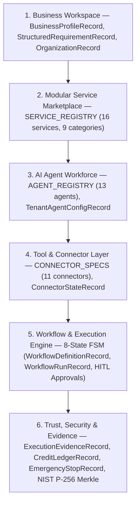

# Platform Architecture — AskforWrite AI Company OS (P1 Modular SME Edition)

## 1. Unified 6-Layer Modular Architecture

AskforWrite AI Company OS separates platform governance (Owner Console) from tenant operations (Customer Business Control Center) while backing both with a single source-of-truth registry and immutable evidence chain.

---

## 2. Database Schema & Migrations

Incremental, backward-compatible Alembic revision chain:
- Previous head: `f6a1b2c3d4e5`
- Current head: `g7b2c3d4e5f6` (`migrations/versions/g7b2c3d4e5f6_add_p1_modular_workforce_tables.py`)

Ten additive P1 tables created by `g7b2c3d4e5f6`:
1. `business_profiles` (`BusinessProfileRecord`): 13-field SME profile, extracted plan recommendation, explicit confirmation flag (`selection_confirmed`, `confirmed_at`), `org_id` unique constraint.
2. `structured_requirements` (`StructuredRequirementRecord`): normalized requirement rows mapped to `recommended_modules`, `recommended_agents`, `required_connectors`, `expected_monthly_credits`, `limitations`, and `status`.
3. `tenant_subscription_profiles` (`TenantSubscriptionRecord`): 15+ field modular package contract per tenant (`internal_sku`, `billing_type`, `billing_interval`, `included_modules`, `selected_modules`, `entitled_agents`, `included_credits`, `seat_limit`, `customization_allowance`, `renewal_policy`).
4. `tenant_agent_configs` (`TenantAgentConfigRecord`): per-`(org_id, agent_id)` activation state, model override, `execution_mode`, `tool_allowlist`, and `execution_limits`.
5. `connector_states` (`ConnectorStateRecord`): per-`(org_id, connector_id)` configuration summary, `connection_status`, `capability_state`, `last_verified_at`, and `last_error` (no raw secrets).
6. `workflow_definitions` (`WorkflowDefinitionRecord`): versioned workflow steps (`steps_json`), `trigger_type`, `schedule_cron`, `max_credits_budget`, `timeout_seconds`, and `max_retries`.
7. `workflow_runs` (`WorkflowRunRecord`): explicit 8-state FSM (`DRAFT`, `READY`, `RUNNING`, `WAITING_APPROVAL`, `COMPLETED`, `FAILED`, `CANCELLED`, `BLOCKED`), idempotency key, step results, and linked `approval_id`.
8. `execution_evidence_records` (`ExecutionEvidenceRecord`): durable execution provenance (`execution_id`, `tenant_id`, `workflow_id`, `agent_id`, `connector_id`, `execution_mode`, `output_origin`, redacted `input_reference`/`output_reference`, `provider_request_id`, `fallback_used`, `approval_id`, `credits_consumed`, `evidence_reference`, `version`).
9. `credit_ledger_records` (`CreditLedgerRecord`): atomic double-entry credit events (`GRANT`, `RESERVE`, `COMMIT`, `REFUND`, `TOPUP`) with unique `idempotency_key`.
10. `emergency_stop_records` (`EmergencyStopRecord`): persistent circuit-breakers across four scopes (`execution`, `agent`, `tenant`, `platform`).

---

## 3. Customer Control Center vs. Owner Console Isolation

- **Frontend (`app/dashboard/`):** Single PWA shell (`sw.js`: `afw-os-shell-v4.0-p1-workforce`), strict pre-auth login gate, and role-segmented navigation inside `checkAuthGate()`.
  - **Customer users** access the 12-item **Business Control Center**: `Overview`, `Business Profile`, `Service Marketplace`, `AI Workforce`, `Agent Run Console`, `Workflow Builder`, `Connected Tools`, `Tasks & Execution History`, `Approvals`, `Analytics & Reports`, `Subscription & Billing`, `Settings & Security`. Owner navigation and `#settings-owner-key-group` remain hidden.
  - **Platform owners/managers** retain the Owner Console (`Control Tower`, `Prospect Leads`, `Watchdog`, `Owner DirectPay Settlement Queue`, platform revenue analytics).
- **Backend RBAC (`app/security/auth.py`):** `require_tenant_operator` permits org-scoped tenant administration (`role == "customer"` with `org_id`) and platform operators while enforcing strict `org_id` isolation across `/v1/me/*`, `/v1/registry/*`, and `/v1/workflows/*`. Cross-tenant resource lookups return `403` or `404` and never leak sibling tenant records.
